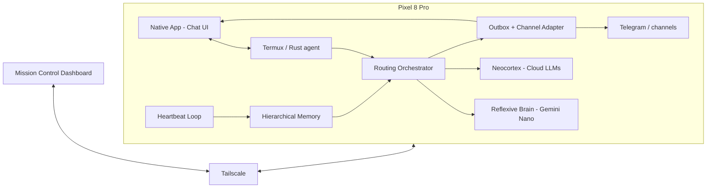

# Best-in-Class Pixel Agent: Build-from-Scratch Blueprint

This blueprint implements the **custom autonomous agent** described in *Pixel 8 Pro AI Agent Alternatives*: no reliance on the existing Jarvis app as the core. We build the doc’s stack end-to-end.

**No language religion.** Optimize for **clean**, **fast**, **resilient**, and **scalable**:

| Principle | What it means for this stack |
|-----------|-----------------------------|
| **Clean** | Clear boundaries (gateway ↔ orchestrator ↔ LLMs); minimal dependencies; config over code; one responsibility per process or module. |
| **Fast** | Low latency for chat and voice; single binary or few processes where it helps; avoid unnecessary hops; stream when possible. |
| **Resilient** | Agent and gateway survive restarts (Termux, Android); backoff and retries for cloud LLMs and channels; no silent failures; heartbeat in isolated sessions to avoid memory leaks. |
| **Scalable** | Stateless gateway so we can add clients (app, Mission Control, Telegram) without rewriting; memory and routing scale by config (turns, token limits, model choice); optional horizontal scaling later (e.g. more agents or workers). |

**Language and runtime** follow from that: use whatever runs on Android/Linux and best fits the component. **Current choice for the agent core: Rust.** Single binary, no runtime, strong fit for fast + resilient; cross-compile to `aarch64-linux` for Termux. We can pivot to **Go** if we hit friction (e.g. async/ecosystem pain or need to ship a prototype faster); Go is simpler and compiles faster. **Kotlin** for the native app (chat, voice, AICore). **Python** only for scripts or one-off glue. Per-component consistency matters more than one language everywhere.

**How we build: slow to go fast, test along the way.** We take small steps, validate each one, and only then add the next. No big-bang integration. Each phase has a **test checkpoint**: a concrete “done when” we can run or assert before moving on. That keeps the stack understandable, debuggable, and easy to change. Speed comes from not reworking large chunks later.

---

## 1. Target Architecture (from the doc)



- **Native app (Android Studio)**: **Chat UI** for on-device comms, text and **voice** (“talk” to the agent); notifications for proactive messages; optional in-app AICore/Gemini Nano. Connects to the agent over localhost (Termux-bridged port or in-app gateway). Voice: mic → speech-to-text → agent → response → optional text-to-speech so you can have a conversation hands-free when we get the stack that advanced.
- **Termux / Rust agent**: Single binary (or a small set of bins) for orchestrator, gateway, heartbeat, memory, outbox. **Termux:API** (via subprocess or a small bridge) for SMS, GPS, clipboard, TTS when needed.
- **Routing orchestrator**: Bicameral Mind, classifies task, sends to Reflexive (on-device) or Neocortex (cloud).
- **Reflexive**: High-frequency, low-complexity. **On-device Gemini Nano** via AICore (native app or Project Heimdall in Termux when viable) or fallback local endpoint.
- **Neocortex**: Complex reasoning. **Cloud**: Claude 3.5 Sonnet, Gemini 1.5/2.5 Pro.
- **Heartbeat**: Think–Decide–Act–Observe on a schedule; isolated session to avoid memory leaks.
- **Memory**: Last 5 turns verbatim; summarization → macro-summaries; operational data as pointers only.
- **Outbox**: Proactive messages to `.data/outbox/`; adapter sends to **Telegram** and/or **native app** (in-app notifications / chat).
- **Tailscale**: Stable IP, remote access, optional remote ADB.
- **Mission Control**: Web dashboard for telemetry, Kanban, SOUL edits; connects to the agent gateway over Tailscale.

---

## 2. Infrastructure (Phase 1)

### 2.1 Android 14 phantom process killer bypass

Run once via ADB (device connected, USB debugging on):

```bash
adb shell device_config put activity_manager max_phantom_processes 2147483647
adb shell settings put global settings_enable_monitor_phantom_procs false
adb shell device_config set_sync_disabled_for_tests persistent
```

**Effect**: Raises background process limit so the agent can run many threads/processes without being killed. Document in repo; warn that this changes system behavior.

### 2.2 Termux and Termux:API

- Install **Termux** from F-Droid or [GitHub releases](https://github.com/termux/termux-app/releases) (not Play Store).
- Install **Termux:API** APK from F-Droid; in Termux run: `pkg install termux-api`.
- Agent code can then use: SMS, GPS, clipboard, TTS, etc., for context and tools.

### 2.3 Optional: Tensor G3 core pinning and GPU

- Use **taskset** to pin:
  - Idle/telemetry/listeners → Cortex-A510 (efficiency cores).
  - ASR / wake-word → Cortex-A715.
  - LLM prefill/generation → Cortex-X3 (prime).
- **Vulkan ICD**: Point loader at `/vendor/lib64/hw/vulkan.mali.so` for GPU-accelerated inference if/when we run our own model (optional; doc mentions it for heavy LLM work).

**Deliverable:** Script or doc that applies phantom bypass; Termux + Termux:API setup; optional taskset/Vulkan notes.  
**Test checkpoint:** Termux runs and stays up; `termux-api` responds; script/docs exist and are runnable. Don’t start Phase 2 until this passes.

---

## 2.5 On-device native app (Android Studio)

Use **Android Studio** and **Kotlin** when a native app is better or faster to manage than a Termux-only flow.

### When a native app helps

- **Chat UI**: On-device conversation with the agent without opening Telegram or SSH. List view of turns, input field, optional markdown/streaming. Much better UX than Termux for daily use.
- **Voice (“talk” to the agent)**: Built into the app and plan so we can add it once the stack is advanced enough. **Input**: mic → speech-to-text (STT) → send as text to the agent. **Output**: agent reply shown in chat + optional **text-to-speech (TTS)** so the agent “talks back” and you can have a hands-free conversation. See *Voice interaction* below.
- **Proactive comms**: App can receive outbox items (via local gateway or push) and show notifications + in-app messages.
- **AICore / Gemini Nano**: If we call Gemini Nano from the device, doing it from a **native app** (Android SDK) is more reliable than a Termux/Heimdall bridge; the app can expose an HTTP endpoint for the orchestrator (running in Termux or as another process) to call.
- **System integration**: Notifications, foreground service for “agent running” indicator, optional quick settings tile, widgets.

### Architecture options

1. **App as client only**: App talks to the agent over HTTP (e.g. `http://127.0.0.1:PORT`). The agent runs in Termux as the **Rust binary**; Termux-bridged port or `adb reverse` makes it reachable from the app. Chat UI sends user messages and displays responses; can subscribe to outbox/events (poll or WebSocket).
2. **App hosts gateway + UI**: Agent core (Rust binary) still in Termux. A **foreground service** in the app runs a small HTTP/WebSocket gateway that the chat UI and Mission Control call; the gateway forwards to the agent. Keeps one place for “how to talk to the agent” and lets the app own notifications and lifecycle.
3. **Heavy lifting in-app**: For maximum integration, move orchestrator + reflexive into the app (Kotlin); Termux only for cron/heartbeat and tools (shell, Termux:API). Bigger refactor; do only if we want AICore in-app and a single process.

**Recommendation**: Start with **(1) App as client only**, minimal Android surface (chat UI + optional notification receiver), Rust agent and gateway in Termux. Add **(2)** if we want one stable endpoint for both the app and Mission Control.

### Tech stack for the app

- **Language**: Kotlin.
- **UI**: Jetpack Compose; list of messages + `TextField` + send; optional streaming via SSE or WebSocket.
- **Network**: Retrofit or Ktor client to agent gateway; OkHttp for SSE/WebSocket if we add streaming.
- **Secrets**: Use Android Keystore or encrypted preferences for API keys if the app ever holds them; otherwise agent holds keys and app only talks to localhost.

### Voice interaction (“talk” to the agent)

Planned for the app so we can add it once the agent and gateway are solid. Goal: **talk to the agent** (speech in, optional speech out) for hands-free use.

- **Speech-to-text (STT)**  
  - **On-device**: Android `SpeechRecognizer` (Google or device OEM); no network required, good latency. Requires `RECORD_AUDIO`; handle no-match and errors.  
  - **Optional cloud**: Whisper or cloud STT for better accuracy in noisy environments; use only when user opts in or on-device fails.
- **Flow**: User taps mic → record (or hold-to-talk) → STT → text sent to agent gateway as a normal user message → response shown in chat.
- **Text-to-speech (TTS)**  
  - Android `TextToSpeech` (built-in); multiple voices/locales.  
  - **UX**: “Read aloud” button on the latest agent message, or auto-play agent replies in “voice mode” (toggle in settings). Stop/resume and skip to next message.
- **UX in chat**: Mic FAB or inline; optional “voice mode” that keeps the conversation going (you speak → agent replies → TTS plays → you speak again). Show a clear listening/speaking state so the user knows when to talk.
- **When to build**: After the chat UI and gateway work reliably (Phase 5 app deliverable). Add STT first (type or speak), then TTS for full “talk” support.

Deliverable (app): Android project (e.g. `pixel-agent-app/`); chat screen (text + send); **later**: mic → STT → agent → reply; optional TTS (“read aloud” or voice mode) so you can talk to the agent when we get it that advanced.

---

## 3. On-device LLM and routing (Phase 2)

### 3.1 Reflexive brain (on-device)

- **Preferred**: **Gemini Nano** via Android AICore. The doc cites [Project Heimdall / FreeGeminiNano](https://github.com/MartialTerran/Project_FreeGeminiNano-A_Python_Bridge_for_Chrome-s_On-Device_Gemini_Nano) as a Python bridge from Termux to Chrome’s on-device model. Status: experimental (reverse-engineering); use when stable or accept fallback.
- **Fallback**: Local HTTP endpoint (e.g. Ollama, or a minimal server that wraps AICore if we implement one) so the orchestrator can call “reflexive” without blocking on Heimdall.

### 3.2 Neocortex (cloud)

- **Claude 3.5 Sonnet**: Primary for coding and multi-step tool use (API key or OAuth).
- **Gemini 1.5 Pro / 2.5 Pro**: For very long context (docs, codebase, long chains). Configure via API key.
- Routing table (YAML or JSON): Map task type or classifier output → model id (e.g. `reflexive`, `claude-3.5-sonnet`, `gemini-1.5-pro`).

### 3.3 Routing orchestrator

- **Input**: User message or heartbeat context.
- **Classifier**: Rule-based, embedding similarity, or a cheap/fast LLM (e.g. Titan Text G1 Express) to choose reflexive vs neocortex (and which cloud model).
- **Output**: Single model call (or tool loop) and response.
- **Implementation**: **Rust** (current choice): orchestrator lives in the same binary as gateway/heartbeat/memory; single deployable. Orchestrator runs in Termux; if we later move to “gateway in app”, the app can host a thin HTTP layer and forward to the Rust agent.

**Deliverable:** `routing/` (or equivalent) with config schema, classifier, and clients for reflexive + cloud; integrate Project Heimdall when feasible or document fallback; optionally AICore from native app. **Gateway:** HTTP/WS endpoint for app and Mission Control.  
**Test checkpoint:** One HTTP request to gateway → orchestrator → one LLM call → response returned (manual or automated). Don’t start Phase 3 until this passes.

---

## 4. Heartbeat and outbox (Phase 3)

### 4.1 Heartbeat loop (Think–Decide–Act–Observe)

- **Trigger**: Cron (e.g. every 15–30 min) or internal scheduler; run as **separate process/session** to avoid memory leaks (doc and MonClaw pattern).
- **Context assembly**: Read state from:
  - `HEARTBEAT.md` or SQLite (current context, last actions).
  - Termux:API (notifications, battery, optional calendar).
  - Optional: recent memory window from Phase 5.
- **Reasoning turn**: Send assembled context to **routing orchestrator**; system prompt: “Evaluate state; decide if any proactive action or user notification is needed.”
- **Execution**: If the model returns actions, run tools (e.g. shell, send message). If it decides to notify the user, **write to outbox** (see below).

### 4.2 Outbox mechanism

- **Path**: `.data/outbox/` (under agent home in Termux).
- **Format**: One file per pending message (e.g. JSON or text); metadata: channel (Telegram, etc.), recipient, optional id.
- **Channel adapter**: Small daemon or cron job that:
  - Lists `.data/outbox/`
  - Sends each message via Telegram (and other channels if we add them)
  - Deletes or moves file on success.

**Deliverable:** `heartbeat/` (scheduler, context assembly, one reasoning step, tool execution); `outbox/` (writer + adapter); cron or launch script for heartbeat and adapter.  
**Test checkpoint:** Run one heartbeat manually; a message appears in outbox and is sent (e.g. to Telegram or a test channel). Don’t start Phase 4 until this passes.

---

## 5. Hierarchical memory (Phase 4)

- **Short-term**: Keep last **5 conversational turns** verbatim (user + assistant + optional tool results).
- **Threshold**: When history exceeds ~10k tokens (configurable), trigger **summarization**.
- **Summaries**: Compress oldest segment into a ~1k-token summary; store in a “summaries” store (files or SQLite).
- **Macro-summaries**: When e.g. 6 summaries exist, merge oldest 4 into one macro-summary; keep recent summaries + macro for long-term index.
- **Operational data**: Do not put raw JSON, huge file paths, or big doc dumps into the conversational buffer; store by reference (e.g. “see file X” or “see summary id Y”).

**Deliverable:** `memory/` module with: buffer (last N turns), token count (approximate), summarizer call (using Neocortex or a cheap model), summary store, and inject “recent turns + summary index” into routing/heartbeat prompts.  
**Test checkpoint:** After 6+ turns, prompt includes recent turns + at least one summary; unit or integration test verifies. Don’t start Phase 5 until this passes.

---

## 6. Remote access and dashboard (Phase 5)

### 6.1 Tailscale

- Install Tailscale on the Pixel; join same network as your Mac/laptop.
- Use Pixel’s Tailscale IP for: SSH, remote ADB (`adb connect <ip>:5555` with wireless debugging), and for Mission Control to reach the agent’s gateway (if we expose one).

### 6.2 Mission Control

- **Repo**: [builderz-labs/mission-control](https://github.com/builderz-labs/mission-control) (Next.js 16, React 19, SQLite, WebSocket/SSE, 28 panels, Kanban, Quality Gates).
- **Role**: “Single pane of glass” for the agent: live logs, memory view, token/cost, heartbeat cron, SOUL/personality edits, task Kanban (Planning → Inbox → Assigned → In Progress → Testing → Review → Verification → Done), human sign-off for high-risk actions.
- **Connection**: Mission Control expects a gateway (e.g. OpenClaw-compatible or custom). We either:
  - Implement a **thin gateway API** on the Pixel (in Termux) that exposes: health, tasks, memory summary, logs, and accepts commands; run Mission Control on Mac or a server and point it at the Pixel’s Tailscale IP, or
  - Run Mission Control against a gateway that we run on the Mac that **proxies** to the Pixel (agent reports to Mac; Mission Control talks to Mac).

**Deliverable:** Tailscale on device; decision on “gateway on Pixel” vs “gateway on Mac + agent reports in”; Mission Control setup and connection to our stack; document Ed25519/device identity if required. **Native app:** chat UI, talks to gateway; optional notifications; voice when advanced.  
**Test checkpoint:** App sends a message and shows a reply; device reachable via Tailscale; Mission Control (if wired) shows agent status.

---

## 7. Repo and code layout (suggested)

We build a **new** agent codebase (no dependency on existing Jarvis app logic); it can still call Jarvis HTTP 9090 as one possible “reflexive” backend until Heimdall is ready. **Agent core: Rust** (pivot to Go if we need to). Layout below is Rust-oriented (`Cargo.toml`, `src/`, `crates/` or flat `src/`).

```
pixel-edge-server/
  blueprint/
    BLUEPRINT_BEST_IN_CLASS.md
  pixel-agent/                  # Existing minimal agent (stopgap / fallback)
  pixel-agent-v2/               # New: best-in-class stack, Rust agent
    README.md
    Cargo.toml
    config/
      routing.yaml
      soul.md
    src/
      main.rs
      router.rs                 # Classifier + dispatch to reflexive/neocortex
      reflexive.rs              # Client for Gemini Nano (Heimdall) or local HTTP
      neocortex.rs              # Clients for Claude, Gemini cloud
      heartbeat/
      memory/
      outbox/
      tools/
      gateway/                  # Thin HTTP/WebSocket API for app + Mission Control
    .data/
      outbox/
      memory/
    scripts/
      setup_termux.sh
      phantom_bypass.sh
  pixel-agent-app/              # Native Android (Android Studio), chat UI, voice (STT/TTS), optional gateway
    README.md
    app/
      src/main/
        java/.../               # Kotlin: MainActivity, ChatViewModel; VoiceHelper (STT/TTS); GatewayService (optional)
        res/
    build.gradle.kts
```

- **pixel-agent-v2**: Orchestrator, heartbeat, memory, outbox, gateway in **Rust**; single binary, `adb push` to Termux or run via `./pixel-agent-v2`. Pivot to Go if we need to (same layout ideas).
- **pixel-agent-app**: Kotlin app; chat UI (Compose) that talks to the agent via the gateway (localhost). Optional: foreground service hosting the gateway, notifications for outbox, or AICore/Gemini Nano endpoint.
- **Config**: `routing.yaml` and `.env` (or env only) for API keys, model ids, endpoints. Secrets in env or Android Keystore; never commit tokens.

---

## 8. Phase summary and order

| Phase | Focus | Deliverables | Test checkpoint (done when…) |
|-------|--------|---------------|------------------------------|
| **1** | Infrastructure | Phantom bypass doc/script; Termux + Termux:API; optional taskset/Vulkan notes | Termux runs and stays up; `termux-api` responds; script/docs exist and are runnable. |
| **2** | Routing + LLMs | Reflexive client (Heimdall or fallback); Neocortex clients (Claude, Gemini); routing config and classifier; **gateway** (HTTP/WS) | One HTTP request to gateway → orchestrator → one LLM call → response returned; manual or automated test passes. |
| **3** | Heartbeat + outbox | Heartbeat run (context → reason → act); outbox writer; channel adapter (Telegram + optional app); scheduler | Run one heartbeat manually; a message appears in outbox and is sent (e.g. to Telegram or a test channel). |
| **4** | Memory | Buffer (last 5 turns); summarization; summary store; macro-summaries; inject into prompts | After 6+ turns, prompt includes recent turns + at least one summary; unit or integration test verifies. |
| **5** | Remote + dashboard + app | Tailscale; Mission Control; **native app**: chat UI, gateway, notifications; **voice** (when advanced) | App sends a message and shows a reply; device reachable via Tailscale; Mission Control (if wired) shows agent status. |

Implement in order: **1 → 2 → 3 → 4 → 5**. Do not start the next phase until the **test checkpoint** for the current phase passes. The **native app (chat UI)** can be built as soon as the gateway exists (end of Phase 2 or 3) and fits naturally in Phase 5 with Tailscale and Mission Control. Phase 2 can initially use a single “reflexive” HTTP endpoint (e.g. Jarvis 9090 or Ollama) if Project Heimdall is not yet integrated. **Agent core: Rust** for the Termux binary; pivot to Go if we hit friction.

---

## 9. References (from the doc)

- **Phantom process killer**: Android 14, 32-process limit; ADB `device_config` and `settings` (see section 2.1).
- **Termux**: F-Droid or [termux/termux-app](https://github.com/termux/termux-app); Termux:API for hardware.
- **Project Heimdall (FreeGeminiNano)**: [MartialTerran/Project_FreeGeminiNano-...](https://github.com/MartialTerran/Project_FreeGeminiNano-A_Python_Bridge_for_Chrome-s_On-Device_Gemini_Nano), Python bridge to Chrome’s Gemini Nano; experimental.
- **Mission Control**: [builderz-labs/mission-control](https://github.com/builderz-labs/mission-control), Next.js 16, React 19, SQLite, 28 panels, Kanban, Quality Gates.
- **MonClaw / heartbeat**: Isolated session per run to avoid memory leaks; outbox for proactive messages ([cefboud.com/posts/monclaw-...](https://cefboud.com/posts/monclaw-a-light-openclaw-with-opencode-sdk/)).
- **Hybrid routing**: Reflexive (edge) vs Neocortex (cloud); Claude 3.5 Sonnet (daily), Gemini 1.5/2.5 Pro (long context).
- **Memory**: Last 5 turns verbatim; hierarchical summarization; operational data as pointers (r/AgentsOfAI “I built my agent from scratch”).

This blueprint is the single source of truth for building the doc’s best-in-class Pixel agent. Implement phase by phase; pass each test checkpoint before moving on (slow to go fast, test along the way). Update this file with “Done” sections or links to code as you go.
